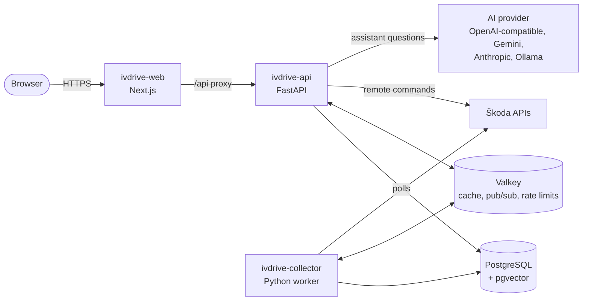
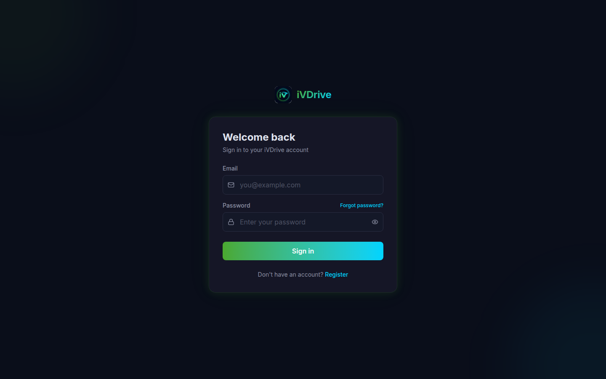
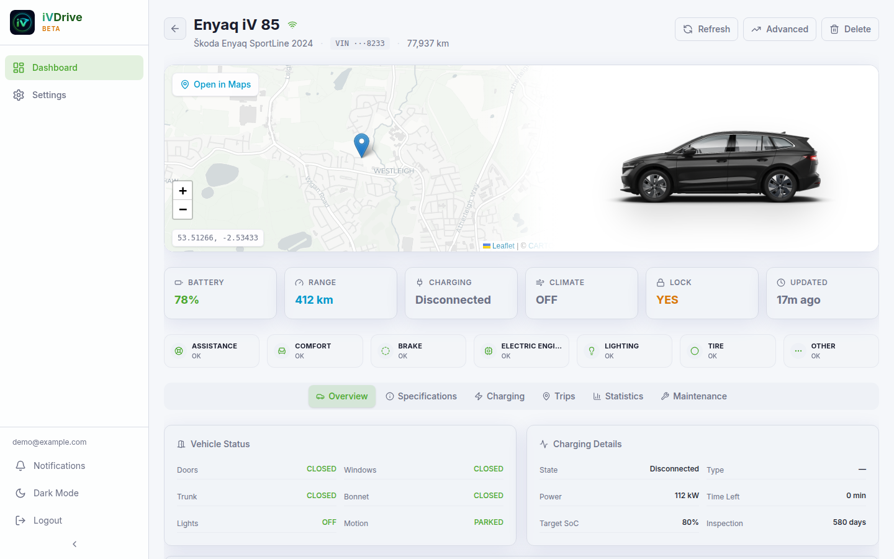
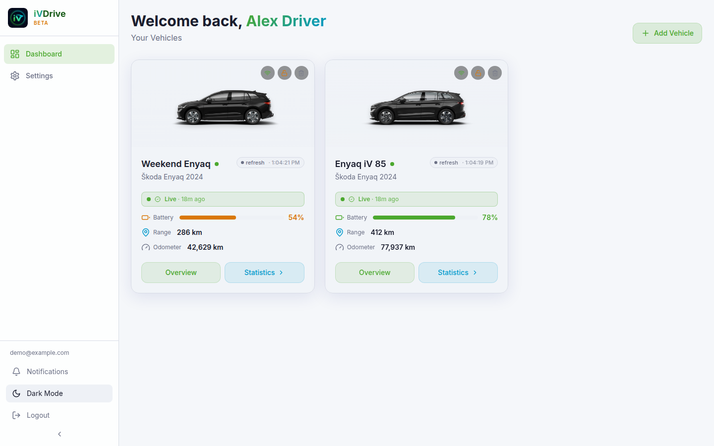

<p align="center">
  <a href="https://ivdrive.eu">
    
  </a>
</p>

<h1 align="center">iVDrive</h1>

<p align="center">
  <strong>Electric vehicle data monitoring and analytics for Volkswagen Group EVs, starting with Škoda.</strong><br>
  Trips, charging, battery health, driving statistics and an assistant that answers questions about <em>your</em> data.
</p>

<p align="center">
  <a href="https://github.com/m7xlab/ivdrive/releases/latest"></a>
  <a href="https://github.com/m7xlab/ivdrive/actions/workflows/lint.yml"></a>
  <a href="https://github.com/m7xlab/ivdrive/actions/workflows/security-scan.yml"></a>
  <a href="LICENSE"></a>
  <a href="https://github.com/m7xlab/ivdrive/stargazers"></a>
</p>

<p align="center">
  <a href="https://ivdrive.eu"><strong>Try iVDrive (beta)</strong></a> ·
  <a href="#-quick-start"><strong>Quick start</strong></a> ·
  <a href="docs/ARCHITECTURE.md"><strong>Architecture</strong></a> ·
  <a href="docs/README.md"><strong>Documentation</strong></a> ·
  <a href="CHANGELOG.md"><strong>Changelog</strong></a> ·
  <a href="ROADMAP.md"><strong>Roadmap</strong></a>
</p>

<p align="center">
  
</p>

> **Beta.** iVDrive is in active development and the hosted service at [ivdrive.eu](https://ivdrive.eu) is invite-only while it scales: [request an invite](https://ivdrive.eu/register). Contributors, feedback and new users are welcome.

---

## ✨ What you get

| | |
|---|---|
| 🚗 **Trips and movement** | Trips detected and reconciled against the Škoda history, an editable trip list, visited places, top places and a time budget of parked, driving, charging and offline time |
| 🔌 **Charging** | Sessions with energy and cost, charging-power curves, charging plans and tariffs, remote start and stop |
| 🔋 **Battery health** | State of health measured from the energy actually charged (not a configured number), confidence ratings, and a monthly battery passport (email and PDF) |
| 📈 **16 statistics views** | Consumption, mileage, range, climate and HVAC penalties, elevation, speed and temperature, ICE-versus-EV cost, route efficiency and more |
| 🤖 **Assistant** | Ask questions about your own vehicles in plain language. It can only read your data: every database lookup is parsed, restricted to analytical tables, and fenced to your user |
| 🛰️ **ABRP live telemetry** *(optional)* | Push state of charge, charging and position to [A Better Route Planner](https://abetterrouteplanner.com). Off by default |
| 🎛️ **Remote commands** | Lock, climate, charging, honk and flash, wake: from the vehicle page |
| 🌍 **Your units and currency** | Metric or imperial, multi-currency costs with exchange rates |
| 🔐 **Sign-in security** | Two-factor authentication with recovery codes, revocable sessions, rate-limited logins, invite-only registration by default |

## 🏗️ Architecture at a glance



The web app proxies `/api/*` to the API, so everything is served from one origin. The same backend image runs the API and the collector. See **[docs/ARCHITECTURE.md](docs/ARCHITECTURE.md)** for data flow, the security model and the repository layout.

## 📸 See it in action

Screenshots from the live app at [ivdrive.eu](https://ivdrive.eu). Light and dark theme available — see [assets/screenshots/](assets/screenshots/).

**App navigation (animated):**


| Login | Add vehicle | Vehicle overview |
|-------|-------------|------------------|
| [](assets/screenshots/login_light_theme.png) | [](assets/screenshots/add_vehicle_light_theme.png) | [](assets/screenshots/overview_light_theme.png) |

| Homepage | Settings |
|----------|----------|
| [](assets/screenshots/homepage_light_theme.png) | [](assets/screenshots/settings_light_theme.png) |

## 🚀 Quick start

### Use it online (no setup)

1. Go to **[ivdrive.eu](https://ivdrive.eu)** and open **Register** to request an invite.
2. Follow the link in the email, then create your account.
3. **Add your vehicle** with the requested credentials. Your data syncs into the dashboard.

### Self-host (advanced)

Requirements: Docker with Compose, and a Škoda Connect account for each vehicle.

```bash
git clone https://github.com/m7xlab/ivdrive.git
cd ivdrive
cp .env.example .env        # set POSTGRES_PASSWORD, VALKEY_PASSWORD, JWT_SECRET_KEY, ENCRYPTION_KEY
docker compose up -d
```

Generate real secrets, for example `python -c "import secrets; print(secrets.token_urlsafe(48))"`. A server will not start with the placeholder values from `.env.example`.

1. **Initialise the database** (fresh installs):
   ```bash
   docker compose exec ivdrive-api env PYTHONPATH=/app python -m app.scripts.init_db
   docker compose exec ivdrive-api env PYTHONPATH=/app alembic stamp head
   ```
2. **Create your first account.** Registration is `invite_only` by default and invites are created by an administrator, so for the very first sign-up set `SERVICE_REGISTRATION=open` in `.env` and run `docker compose up -d`. Open the web UI at http://localhost:3000, register, then promote yourself to administrator:
   ```bash
   docker compose exec ivdrive-api env PYTHONPATH=/app python -m app.scripts.promote_user --email you@example.com
   ```
   Then set `SERVICE_REGISTRATION=invite_only` again (unless you want public sign-up) and run `docker compose up -d`.
3. **Add your vehicle** in the UI.

**Upgrading:** back up the database, run `alembic upgrade head`, then start the new containers. Read the release notes first: some releases (for example v1.4.0) log everyone out once.

Pre-built images for production are published on Docker Hub for amd64 and arm64; [deploy/compose.prebuilt.yml](deploy/compose.prebuilt.yml) is a template that uses them. More detail: [self-hosting guide](docs/self-hosting.md) and [project overview](docs/project_overview.md).

> **Known limitation for fresh self-hosted installs:** the assistant's restricted database role is created by migrations, and the `init_db` plus `stamp` route skips them. Without that role the assistant's custom-SQL tool is unavailable (it fails closed); its other tools work. See the [self-hosting guide](docs/self-hosting.md#assistant-database-role).

## 🔒 Security

Security is checked on every pull request and weekly: **CodeQL**, **Trivy** (image and filesystem), **Gitleaks**, `pip-audit` and `npm audit`, with GitHub secret scanning, push protection and Dependabot alerts enabled. Release v1.4.0 was a dedicated hardening release: the assistant's database access is fenced per user, sessions can be revoked, logins are rate-limited, and dependencies are locked with hashes. Details are in the [changelog](CHANGELOG.md); how to report a vulnerability is in [SECURITY.md](SECURITY.md). **Please do not open public issues for security problems.**

## 📚 Documentation

| | |
|---|---|
| [Architecture](docs/ARCHITECTURE.md) | Components, data flow, security model, repository layout |
| [Project overview](docs/project_overview.md) | Technology stack and directory structure |
| [Self-hosting guide](docs/self-hosting.md) | Run the stack on your own server or NAS |
| [User documentation](documentation/) | Docusaurus site: getting started, user guide, reference |
| [Smart polling](docs/design/smart-polling.md) | How iVDrive watches a car without hammering the Škoda API |
| [Changelog](CHANGELOG.md) · [Roadmap](ROADMAP.md) | What changed and what is planned |

## 🤝 Contributing

Bug reports, feature ideas and pull requests are welcome. Start with the [contributing guide](CONTRIBUTING.md); please follow the [code of conduct](CODE_OF_CONDUCT.md). Every change goes through a pull request that must pass lint, type checks and the security scans.

## 📄 License

iVDrive is **source-available** under the [Elastic License 2.0](LICENSE) (ELv2): you may use, modify and redistribute it subject to the license, which does **not** allow offering the software to third parties as a hosted or managed service. It is not an OSI-approved open-source license.

## 🌟 Star History

[](https://star-history.com/#m7xlab/iVDrive&Date)

---

<p align="center">
  <a href="https://github.com/m7xlab"></a><br>
  <strong>m7xlab</strong> · <a href="https://ivdrive.eu">ivdrive.eu</a> · <a href="docs/THANK-YOU.md">Thank you</a>
</p>

<p align="center">
  <a href="https://github.com/m7xlab/ivdrive/graphs/contributors"></a>
</p>
