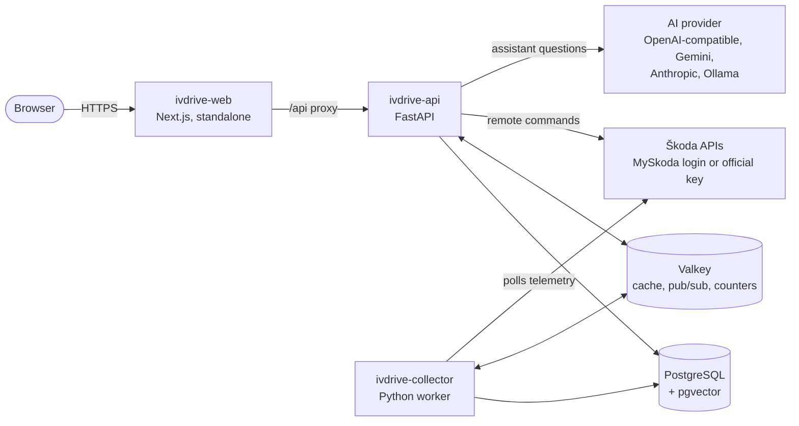
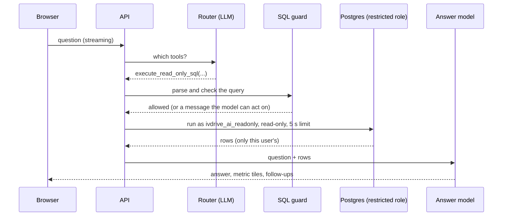
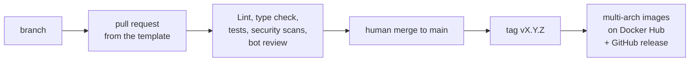

# iVDrive architecture

This page explains how the pieces fit together, how data and requests flow, and where the security boundaries are. For the technology list and directory tour see [project_overview.md](project_overview.md); to run it yourself see [self-hosting.md](self-hosting.md).

## Components



| Service | What it does |
|---|---|
| **ivdrive-web** | Next.js app (App Router). Serves the UI and proxies `/api/*` to the API, so the browser talks to one origin. |
| **ivdrive-api** | FastAPI backend. Authentication, vehicles, statistics, settings, remote commands, the assistant, administration. |
| **ivdrive-collector** | Background worker built from the same backend image. Polls each vehicle on a per-vehicle schedule, normalises the answers and writes them to PostgreSQL. |
| **postgres** | PostgreSQL with the pgvector extension. Users, vehicles, all telemetry history, assistant embeddings and chat history. |
| **valkey** | Redis-compatible store: the 60-second API response cache, rate-limit counters, and pub/sub between the API and the collector. |

## How data flows

**Telemetry.** The collector reads each vehicle either through the MySkoda login or an official Škoda API key. Polling follows a smart schedule (see [Smart polling](design/smart-polling.md)): frequently while the car is active, rarely while it sleeps, so the Škoda API is not hammered and the database does not fill with identical rows. Trips are detected from the telemetry and reconciled against Škoda's own trip history; charging sessions, positions, connection states and battery readings go to their own tables. A remote command or a manual refresh publishes an event through Valkey so the collector polls that car immediately.

**Requests.** The browser holds HttpOnly session cookies plus a readable CSRF token that it sends on every state-changing call. Access and refresh tokens are signed JWTs that carry the account's session version, so changing a password or choosing "log out everywhere" ends every other session. Expensive statistics endpoints are cached for 60 seconds per user and per session version.

**Assistant.** A question goes through a router that decides which tools to call: fixed data tools (current state, battery health, trip and charging statistics), a vector search over embedded vehicle summaries, or a database lookup written by the model. The answer is composed by the configured provider and streamed back with a status heartbeat. Per-tier daily and monthly quotas and a cost log apply.



## Security model

| Layer | How it works |
|---|---|
| **Passwords and secrets** | Passwords are hashed with bcrypt. Vehicle credentials and API keys are encrypted at rest (AES-GCM) with a key that never reaches the database. Recovery codes are stored as keyed hashes. The server refuses to start with placeholder secrets. |
| **Sessions** | HttpOnly cookies, CSRF double-submit, JWT type and version claims. A per-account session version makes password change, reset and "log out everywhere" revoke every session, and cached responses of revoked sessions are dropped. |
| **Brute-force limits** | Login, two-factor, recovery-code, password-change and reset attempts are counted atomically before the password is checked: per account and address, per account, and per address, in 15-minute windows. |
| **Authorization** | Every vehicle, session and plan route scopes by the signed-in user; administration routes require a superuser; deactivated accounts lose data routes immediately. |
| **Assistant database access** | Four independent fences. (1) The model's SQL is parsed by PostgreSQL's own parser and refused unless it is one plain `SELECT` over allow-listed relations calling allow-listed functions. (2) It runs as a restricted database role that can read only those relations. (3) Row-level security keyed on the current user filters every row. (4) The transaction is read-only with a 5-second time limit and a row cap. No single fence has to be perfect. |
| **Supply chain** | Python dependencies are locked with hashes and installed from wheels built in a separate stage; images are rebuilt on the current Debian release; CodeQL, Trivy, Gitleaks, `pip-audit` and `npm audit` run in CI. |

## Database and migrations

Schema changes ship as Alembic migrations (`backend/app/migrations/versions`). A few additive changes are also applied by the API and collector at startup if the migration has not been run yet (`schema_ensure`), so a late migration does not break sign-in. The supported upgrade order is still: back up, run `alembic upgrade head`, then start the new containers. Tables the assistant reads are protected by row-level security; the assistant's database role and policies are created by migrations.

## Repository layout

```text
iVDrive/
├── backend/            FastAPI app and the collector (app/api, app/services, app/models, app/migrations)
│   └── tests/          unit tests and Postgres "replay" tests that run real sync and security scenarios
├── frontend/           Next.js web app (src/app, src/components, src/lib)
├── documentation/      User documentation site (Docusaurus)
├── landing/            Public marketing site and edge proxy (optional)
├── docs/               Architecture, self-hosting, design notes, brand guide, development guides
├── deploy/             Compose template that uses the pre-built Docker Hub images
├── assets/             Logos and screenshots used by the README
├── caddy/              Reverse-proxy configuration for the landing setup
└── .github/            Workflows, issue and pull request templates, code owners, Dependabot config
```

## Build, review and release



Every change goes through a pull request; a person reads and merges it. Pushing a `v*` tag builds the API, collector and web images for amd64 and arm64 and publishes them. Release notes are written for operators first: what changed for users, and what to do when deploying.
